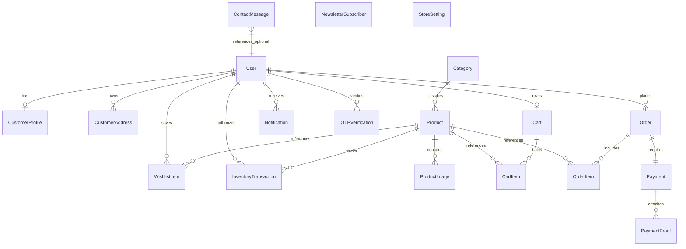

# ANTIKATKO Backend — Database Architecture & Schema Design

**Document Version:** 1.0.0  
**Target RDBMS:** PostgreSQL (compatible with SQLite for local isolated testing)  
**Status:** Approved for Implementation  

---

## 1. Relational Architecture Diagram



---

## 2. Model Specifications by Domain

### 2.1. Accounts (`apps.accounts`)

#### Model: `User` (Custom AbstractBaseUser)
- **Table:** `accounts_user`
- **Fields:**
  - `id`: `BigAutoField`, Primary Key
  - `email`: `EmailField`, unique, indexed, max_length=255. Primary login identifier (`USERNAME_FIELD`).
  - `username`: `CharField`, unique, indexed, max_length=150.
  - `first_name`: `CharField`, max_length=150, blank=True.
  - `last_name`: `CharField`, max_length=150, blank=True.
  - `phone_number`: `CharField`, max_length=20, blank=True.
  - `role`: `CharField`, max_length=10, choices=[(`CUSTOMER`, 'Customer'), (`ADMIN`, 'Admin')], default=`CUSTOMER`, indexed.
  - `is_active`: `BooleanField`, default=True.
  - `is_staff`: `BooleanField`, default=False.
  - `is_email_verified`: `BooleanField`, default=False.
  - `is_phone_verified`: `BooleanField`, default=False.
  - `date_joined`: `DateTimeField`, default=timezone.now.
  - `last_login`: `DateTimeField`, null=True, blank=True.

#### Model: `OTPVerification`
- **Table:** `accounts_otp_verification`
- **Purpose:** Secure verification for registration, password reset, and guest order linking.
- **Fields:**
  - `id`: `BigAutoField`, Primary Key
  - `user`: `ForeignKey(User, on_delete=CASCADE, null=True, blank=True, related_name='otp_records')`
  - `identifier`: `CharField(max_length=255, db_index=True)` (Email or phone)
  - `purpose`: `CharField(max_length=30, choices=['REGISTRATION', 'PASSWORD_RESET', 'PHONE_VERIFY', 'GUEST_ORDER_LINK'])`
  - `otp_hash`: `CharField(max_length=128)` (Salted SHA-256 hash of 6-digit numeric OTP)
  - `expires_at`: `DateTimeField(db_index=True)` (Valid for 10 minutes)
  - `attempts`: `PositiveSmallIntegerField(default=0)` (Max 5 attempts)
  - `is_used`: `BooleanField(default=False)`
  - `created_at`: `DateTimeField(auto_now_add=True)`
- **Constraints & Indexes:**
  - Index on `(identifier, purpose, is_used)`

#### Model: `GuestOrderLinkVerification`
- **Table:** `accounts_guest_order_link`
- **Purpose:** Audit and link verified guest purchases to a registered customer account.
- **Fields:**
  - `id`: `BigAutoField`, Primary Key
  - `user`: `ForeignKey(User, on_delete=CASCADE, related_name='guest_links')`
  - `verified_email`: `EmailField()`
  - `orders_linked_count`: `PositiveIntegerField(default=0)`
  - `created_at`: `DateTimeField(auto_now_add=True)`

---

### 2.2. Customers (`apps.customers`)

#### Model: `CustomerProfile`
- **Table:** `customers_profile`
- **Fields:**
  - `id`: `BigAutoField`, Primary Key
  - `user`: `OneToOneField(User, on_delete=CASCADE, related_name='customer_profile')`
  - `avatar`: `ImageField(upload_to='avatars/', null=True, blank=True)`
  - `notes`: `TextField(blank=True)`
  - `date_of_birth`: `DateField(null=True, blank=True)`
  - `created_at`: `DateTimeField(auto_now_add=True)`
  - `updated_at`: `DateTimeField(auto_now=True)`

#### Model: `CustomerAddress`
- **Table:** `customers_address`
- **Fields:**
  - `id`: `BigAutoField`, Primary Key
  - `user`: `ForeignKey(User, on_delete=CASCADE, related_name='addresses')`
  - `title`: `CharField(max_length=50)` (e.g., "Home", "Office")
  - `recipient_name`: `CharField(max_length=150)`
  - `phone_number`: `CharField(max_length=20)`
  - `governorate`: `CharField(max_length=100)`
  - `city`: `CharField(max_length=100)`
  - `street_address`: `TextField()`
  - `building_number`: `CharField(max_length=50, blank=True)`
  - `floor_number`: `CharField(max_length=50, blank=True)`
  - `apartment_number`: `CharField(max_length=50, blank=True)`
  - `postal_code`: `CharField(max_length=20, blank=True)`
  - `is_default`: `BooleanField(default=False)`
  - `created_at`: `DateTimeField(auto_now_add=True)`
  - `updated_at`: `DateTimeField(auto_now=True)`
- **Business Rule:** Only one default address per customer enforced via model save method and application service.

---

### 2.3. Catalog (`apps.catalog`)

#### Model: `Category`
- **Table:** `catalog_category`
- **Fields:**
  - `id`: `BigAutoField`, Primary Key
  - `name_en`: `CharField(max_length=200)`
  - `name_ar`: `CharField(max_length=200)`
  - `slug`: `SlugField(max_length=200, unique=True, db_index=True)`
  - `description_en`: `TextField(blank=True)`
  - `description_ar`: `TextField(blank=True)`
  - `image`: `ImageField(upload_to='categories/', null=True, blank=True)`
  - `is_active`: `BooleanField(default=True, db_index=True)`
  - `created_at`: `DateTimeField(auto_now_add=True)`
  - `updated_at`: `DateTimeField(auto_now=True)`

#### Model: `Product`
- **Table:** `catalog_product`
- **Fields:**
  - `id`: `BigAutoField`, Primary Key
  - `category`: `ForeignKey(Category, on_delete=PROTECT, related_name='products')`
  - `name_en`: `CharField(max_length=255, db_index=True)`
  - `name_ar`: `CharField(max_length=255, db_index=True)`
  - `slug`: `SlugField(max_length=255, unique=True, db_index=True)`
  - `description_en`: `TextField(blank=True)`
  - `description_ar`: `TextField(blank=True)`
  - `price`: `DecimalField(max_digits=12, decimal_places=2, db_index=True)` (Selling price)
  - `original_price`: `DecimalField(max_digits=12, decimal_places=2, null=True, blank=True)`
  - `stock`: `PositiveIntegerField(default=0, db_index=True)`
  - `main_image`: `ImageField(upload_to='products/%Y/%m/')`
  - `is_active`: `BooleanField(default=True, db_index=True)`
  - `is_featured`: `BooleanField(default=False, db_index=True)`
  - `is_archived`: `BooleanField(default=False, db_index=True)`
  - `created_at`: `DateTimeField(auto_now_add=True, db_index=True)`
  - `updated_at`: `DateTimeField(auto_now=True)`
- **Check Constraints:** `CheckConstraint(check=Q(price__gte=0), name='product_price_non_negative')`

#### Model: `ProductImage`
- **Table:** `catalog_product_image`
- **Fields:**
  - `id`: `BigAutoField`, Primary Key
  - `product`: `ForeignKey(Product, on_delete=CASCADE, related_name='images')`
  - `image`: `ImageField(upload_to='products/gallery/%Y/%m/')`
  - `alt_text`: `CharField(max_length=255, blank=True)`
  - `display_order`: `PositiveSmallIntegerField(default=0)`
  - `created_at`: `DateTimeField(auto_now_add=True)`

---

### 2.4. Cart & Wishlist (`apps.cart`, `apps.wishlist`)

#### Model: `Cart`
- **Table:** `cart_cart`
- **Fields:**
  - `id`: `BigAutoField`, Primary Key
  - `user`: `OneToOneField(User, on_delete=CASCADE, related_name='cart')`
  - `created_at`: `DateTimeField(auto_now_add=True)`
  - `updated_at`: `DateTimeField(auto_now=True)`

#### Model: `CartItem`
- **Table:** `cart_item`
- **Fields:**
  - `id`: `BigAutoField`, Primary Key
  - `cart`: `ForeignKey(Cart, on_delete=CASCADE, related_name='items')`
  - `product`: `ForeignKey(Product, on_delete=CASCADE)`
  - `quantity`: `PositiveIntegerField(default=1)`
  - `created_at`: `DateTimeField(auto_now_add=True)`
  - `updated_at`: `DateTimeField(auto_now=True)`
- **Constraints:** `UniqueConstraint(fields=['cart', 'product'], name='unique_cart_product')`

#### Model: `WishlistItem`
- **Table:** `wishlist_item`
- **Fields:**
  - `id`: `BigAutoField`, Primary Key
  - `user`: `ForeignKey(User, on_delete=CASCADE, related_name='wishlist_items')`
  - `product`: `ForeignKey(Product, on_delete=CASCADE, related_name='wishlisted_by')`
  - `created_at`: `DateTimeField(auto_now_add=True)`
- **Constraints:** `UniqueConstraint(fields=['user', 'product'], name='unique_user_wishlist_product')`

---

### 2.5. Inventory (`apps.inventory`)

#### Model: `InventoryTransaction`
- **Table:** `inventory_transaction`
- **Fields:**
  - `id`: `BigAutoField`, Primary Key
  - `product`: `ForeignKey(Product, on_delete=CASCADE, related_name='inventory_transactions')`
  - `transaction_type`: `CharField(max_length=30, choices=['STOCK_IN', 'STOCK_OUT', 'STOCK_ADJUSTMENT', 'ORDER_DEDUCTION', 'ORDER_RESTOCK'])`
  - `previous_stock`: `IntegerField()`
  - `quantity_change`: `IntegerField()`
  - `new_stock`: `IntegerField()`
  - `reason`: `CharField(max_length=255)`
  - `related_order_number`: `CharField(max_length=64, blank=True, db_index=True)`
  - `created_by`: `ForeignKey(User, on_delete=SET_NULL, null=True, blank=True, related_name='inventory_actions')`
  - `created_at`: `DateTimeField(auto_now_add=True, db_index=True)`

---

### 2.6. Orders & Checkout (`apps.orders`)

#### Model: `Order`
- **Table:** `orders_order`
- **Fields:**
  - `id`: `BigAutoField`, Primary Key
  - `order_number`: `CharField(max_length=64, unique=True, db_index=True)` (e.g. `ANT-20261107-1A2B3C`)
  - `user`: `ForeignKey(User, on_delete=SET_NULL, null=True, blank=True, related_name='orders')`
  - `guest_access_token`: `CharField(max_length=128, unique=True, null=True, blank=True, db_index=True)`
  - `status`: `CharField(max_length=20, default='PENDING', choices=['PENDING', 'CONFIRMED', 'PROCESSING', 'SHIPPED', 'DELIVERED', 'CANCELLED'], db_index=True)`
  - Contact Information:
    - `customer_name`: `CharField(max_length=150)`
    - `customer_email`: `EmailField(db_index=True)`
    - `customer_phone`: `CharField(max_length=20, db_index=True)`
  - Shipping Address Snapshot:
    - `shipping_governorate`: `CharField(max_length=100)`
    - `shipping_city`: `CharField(max_length=100)`
    - `shipping_street_address`: `TextField()`
    - `shipping_building`: `CharField(max_length=50, blank=True)`
    - `shipping_floor`: `CharField(max_length=50, blank=True)`
    - `shipping_apartment`: `CharField(max_length=50, blank=True)`
    - `shipping_notes`: `TextField(blank=True)`
  - Financial Totals (Server Calculated):
    - `subtotal`: `DecimalField(max_digits=12, decimal_places=2)`
    - `shipping_fee`: `DecimalField(max_digits=10, decimal_places=2, default=100.00)`
    - `discount_amount`: `DecimalField(max_digits=10, decimal_places=2, default=0.00)`
    - `total`: `DecimalField(max_digits=12, decimal_places=2)`
  - Payment Method:
    - `payment_method`: `CharField(max_length=30, choices=['vodafone_cash', 'instapay', 'cash_on_delivery'])`
  - Workflow & Auditing:
    - `admin_notes`: `TextField(blank=True)`
    - `cancellation_reason`: `TextField(blank=True)`
    - `cancelled_at`: `DateTimeField(null=True, blank=True)`
    - `is_stock_restored`: `BooleanField(default=False)`
    - `created_at`: `DateTimeField(auto_now_add=True, db_index=True)`
    - `updated_at`: `DateTimeField(auto_now=True)`

#### Model: `OrderItem`
- **Table:** `orders_order_item`
- **Fields:**
  - `id`: `BigAutoField`, Primary Key
  - `order`: `ForeignKey(Order, on_delete=CASCADE, related_name='items')`
  - `product`: `ForeignKey(Product, on_delete=SET_NULL, null=True, blank=True, related_name='order_items')`
  - Historical Snapshots:
    - `product_id_snapshot`: `PositiveIntegerField()`
    - `product_name_en`: `CharField(max_length=255)`
    - `product_name_ar`: `CharField(max_length=255)`
    - `unit_price`: `DecimalField(max_digits=12, decimal_places=2)`
    - `quantity`: `PositiveIntegerField(default=1)`
    - `line_subtotal`: `DecimalField(max_digits=12, decimal_places=2)`

---

### 2.7. Payments (`apps.payments`)

#### Model: `Payment`
- **Table:** `payments_payment`
- **Fields:**
  - `id`: `BigAutoField`, Primary Key
  - `order`: `OneToOneField(Order, on_delete=CASCADE, related_name='payment')`
  - `payment_method`: `CharField(max_length=30, choices=['vodafone_cash', 'instapay', 'cash_on_delivery'])`
  - `status`: `CharField(max_length=20, default='PENDING', choices=['PENDING', 'UNPAID', 'PAID', 'FAILED'], db_index=True)`
  - `amount`: `DecimalField(max_digits=12, decimal_places=2)`
  - `transaction_reference`: `CharField(max_length=120, blank=True, db_index=True)`
  - `proof_image`: `ImageField(upload_to='payment_proofs/%Y/%m/', null=True, blank=True)`
  - `verified_by`: `ForeignKey(User, on_delete=SET_NULL, null=True, blank=True, related_name='verified_payments')`
  - `verification_timestamp`: `DateTimeField(null=True, blank=True)`
  - `rejection_reason`: `TextField(blank=True)`
  - `admin_notes`: `TextField(blank=True)`
  - `created_at`: `DateTimeField(auto_now_add=True)`
  - `updated_at`: `DateTimeField(auto_now=True)`

#### Model: `PaymentProof`
- **Table:** `payments_payment_proof`
- **Fields:**
  - `id`: `BigAutoField`, Primary Key
  - `payment`: `ForeignKey(Payment, on_delete=CASCADE, related_name='proof_submissions')`
  - `proof_image`: `ImageField(upload_to='payment_proofs/%Y/%m/')`
  - `transaction_reference`: `CharField(max_length=120, blank=True)`
  - `sender_info`: `CharField(max_length=255, blank=True)` (Phone or account identifier)
  - `status`: `CharField(max_length=20, default='PENDING', choices=['PENDING', 'ACCEPTED', 'REJECTED'])`
  - `review_notes`: `TextField(blank=True)`
  - `reviewed_by`: `ForeignKey(User, on_delete=SET_NULL, null=True, blank=True)`
  - `reviewed_at`: `DateTimeField(null=True, blank=True)`
  - `submitted_at`: `DateTimeField(auto_now_add=True)`

---

### 2.8. Store Modules (`apps.contact`, `apps.newsletter`, `apps.store_settings`, `apps.notifications`)

#### Model: `ContactMessage` (`apps.contact`)
- **Table:** `contact_message`
- **Fields:** `id`, `name`, `email`, `phone`, `subject`, `message`, `is_read`, `responded`, `created_at`.

#### Model: `NewsletterSubscriber` (`apps.newsletter`)
- **Table:** `newsletter_subscriber`
- **Fields:** `id`, `email (unique)`, `is_active (default True)`, `subscribed_at`.

#### Model: `StoreSetting` (`apps.store_settings`)
- **Table:** `store_settings_setting`
- **Fields:** `id`, `key (unique)`, `value (JSONField or TextField)`, `description`, `updated_at`. Preloaded with shipping fee (100.00), Vodafone Cash number, InstaPay handle.

#### Model: `Notification` (`apps.notifications`)
- **Table:** `notifications_notification`
- **Fields:** `id`, `recipient (FK User, null=True for system broadcasts)`, `title`, `message`, `notification_type (ORDER, PAYMENT, INVENTORY, SYSTEM)`, `is_read`, `link_url`, `created_at`.

---

## 3. Concurrency, Atomicity, and Locking Strategy

1. **Checkout & Stock Deduction:**
   ```python
   with transaction.atomic():
       # Row-level pessimistic locking prevents race conditions
       products = Product.objects.select_for_update().filter(id__in=product_ids)
       # Verify sufficient stock for all items
       # Deduct stock and record InventoryTransaction
       # Create Order, OrderItem, and Payment atomically
   ```
2. **Order Cancellation & Restock:**
   ```python
   with transaction.atomic():
       order = Order.objects.select_for_update().get(id=order_id)
       if order.status == 'CANCELLED' or order.is_stock_restored:
           raise BusinessLogicError("Stock already restored or ineligible.")
       # Restock each product with InventoryTransaction
       order.status = 'CANCELLED'
       order.is_stock_restored = True
       order.save()
   ```
