# ANTIKATKO API — Postman Testing & Integration Guide

Welcome to the **ANTIKATKO** API testing guide. This document provides clear, end-to-end instructions for importing, configuring, and executing the complete Postman collection and environment for local development, QA testing, and frontend integration.

---

## 1. File Artifacts & Locations

All Postman assets are located in the `postman/` directory of the backend repository:

| File | Purpose | Format |
|---|---|---|
| [`ANTIKATKO_API.postman_collection.json`](file:///d:/S%26M%20Apps/ANTIKATKO-backend/postman/ANTIKATKO_API.postman_collection.json) | Complete API collection with 23 folders, 66 requests, automated tests, and actual saved response examples | Postman Collection v2.1.0 |
| [`ANTIKATKO_Local.postman_environment.json`](file:///d:/S%26M%20Apps/ANTIKATKO-backend/postman/ANTIKATKO_Local.postman_environment.json) | Configurable local environment with predefined variables and secrets | Postman Environment v1 |
| [`ACTUAL_TEST_RESULTS.md`](file:///d:/S%26M%20Apps/ANTIKATKO-backend/postman/ACTUAL_TEST_RESULTS.md) | Audit trail of all 66 live requests executed against the backend (100% pass) | Markdown Report |
| [`API_COVERAGE_REPORT.md`](file:///d:/S%26M%20Apps/ANTIKATKO-backend/postman/API_COVERAGE_REPORT.md) | Exhaustive API coverage matrix and security assessment | Markdown Report |

---

## 2. Prerequisites & Local Server Startup

Before sending requests from Postman or Newman, ensure your local Django server is running and populated with seed data.

### Step 2.1: Activate Virtual Environment
Open PowerShell or your preferred terminal inside `D:\S&M Apps\ANTIKATKO-backend`:

```powershell
# Windows PowerShell
.\.venv\Scripts\Activate.ps1
```

### Step 2.2: Verify Database & Apply Migrations
```powershell
python manage.py migrate
```

### Step 2.3: Seed Initial Local Data
Populate the database with administrative accounts, customer accounts, categories, sample antique products, addresses, and store settings:

```powershell
python manage.py seed_local_data
```

**Default Test Credentials Created by Seeder:**
- **Administrator:** `admin@antikatko.com` / `AdminPass123!` (Role: `ADMIN`)
- **Customer:** `customer@antikatko.com` / `CustomerPass123!` (Role: `CUSTOMER`)

### Step 2.4: Start the Django Development Server
```powershell
python manage.py runserver 127.0.0.1:8000
```
Keep this terminal open while testing.

---

## 3. Importing into Postman

### Step 3.1: Import the Collection
1. Launch the Postman desktop application or web agent.
2. In the top-left sidebar, click **Import**.
3. Drag and drop or browse to:
   `D:\S&M Apps\ANTIKATKO-backend\postman\ANTIKATKO_API.postman_collection.json`
4. Confirm import. The collection **ANTIKATKO API** will appear in your Collections sidebar with **23 organized folders**.

### Step 3.2: Import the Environment
1. In Postman, click **Environments** in the left sidebar or the environment dropdown in the top right.
2. Click **Import** and select:
   `D:\S&M Apps\ANTIKATKO-backend\postman\ANTIKATKO_Local.postman_environment.json`
3. Ensure **ANTIKATKO Local Environment** is selected in the active environment dropdown (top right of the Postman interface).

---

## 4. Environment Variables Breakdown

All requests in the collection utilize variables to avoid hardcoded URLs or keys:

| Variable Name | Default Value | Description |
|---|---|---|
| `base_url` | `http://127.0.0.1:8000` | Local server origin |
| `api_prefix` | `/api/v1` | Versioned API route prefix |
| `access_token` | *(Dynamic)* | Current bearer token used by requests inheriting auth |
| `refresh_token` | *(Dynamic)* | SimpleJWT refresh token for rotation/logout |
| `customer_access_token`| *(Dynamic)* | Stored customer JWT access token |
| `admin_access_token` | *(Dynamic)* | Stored administrator JWT access token |
| `guest_access_token` | *(Dynamic)* | Secure token returned from guest checkout for verification |
| `order_number` | *(Dynamic)* | Active order number generated during checkout (e.g. `ANT-20261107-1BA16C`) |
| `guest_order_number` | *(Dynamic)* | Order number generated during guest checkout |
| `product_id` | `1` | ID of sample product |
| `product_slug` | `victorian-velvet-armchair` | URL slug of sample product |
| `category_id` | `1` | ID of sample category |
| `category_slug` | `vintage-chairs` | URL slug of sample category |
| `address_id` | `1` | ID of customer shipping address |
| `cart_item_id` | `1` | ID of active cart line item |
| `order_id` | `1` | Database primary key of order |
| `payment_id` | `1` | Database primary key of payment |

---

## 5. Authentication & Automatic Token Handling

The Postman collection is equipped with **Post-Response Scripts** (Tests) on authentication endpoints that automatically extract and persist JWT tokens to the environment.

### 5.1 Customer Authentication Flow
1. Navigate to `1. Authentication` -> `Login as Customer`.
2. Notice the pre-configured body:
   ```json
   {
     "email": "customer@antikatko.com",
     "password": "CustomerPass123!"
   }
   ```
3. Send the request.
4. The test script automatically saves:
   - `pm.environment.set("customer_access_token", data.data.tokens.access);`
   - `pm.environment.set("access_token", data.data.tokens.access);`
   - `pm.environment.set("refresh_token", data.data.tokens.refresh);`
5. All subsequent customer endpoints (Cart, Wishlist, Profile, Orders) that use `{{access_token}}` or inherit auth are immediately authenticated.

### 5.2 Admin Authentication Flow
1. Navigate to `1. Authentication` -> `Login as Admin`.
2. Notice the pre-configured body:
   ```json
   {
     "email": "admin@antikatko.com",
     "password": "AdminPass123!"
   }
   ```
3. Send the request.
4. The test script automatically saves:
   - `pm.environment.set("admin_access_token", data.data.tokens.access);`
   - `pm.environment.set("access_token", data.data.tokens.access);`
   - `pm.environment.set("refresh_token", data.data.tokens.refresh);`
5. All administrative endpoints (Admin Orders, Admin Payments, Inventory, Dashboard, Reports) will now succeed with full administrator privileges.

### 5.3 Refresh Token Rotation
- SimpleJWT rotates refresh tokens upon each refresh.
- Sending `Refresh Access Token` (`POST /api/v1/auth/token/refresh/`) updates both `access_token` and `refresh_token` in the environment automatically.

---

## 6. End-to-End Testing Workflows

The collection supports three primary end-to-end operational workflows:

```mermaid
flowchart TD
    subgraph Workflow 1: Customer Journey
        W1_A[Login as Customer] --> W1_B[Browse Catalog & Categories]
        W1_B --> W1_C[Add to Cart & Wishlist]
        W1_C --> W1_D[Create/Select Address]
        W1_D --> W1_E[Checkout Order]
        W1_E --> W1_F[Upload Payment Proof]
        W1_F --> W1_G[Check Order Status]
    end

    subgraph Workflow 2: Guest Checkout
        W2_A[Browse Catalog] --> W2_B[Guest Checkout with Details]
        W2_B --> W2_C[Receive Guest Access Token]
        W2_C --> W2_D[View Order with X-Guest-Token]
        W2_C --> W2_E[Upload Payment Proof with X-Guest-Token]
        W2_E --> W2_F[Optional: Link Orders to New Account via OTP]
    end

    subgraph Workflow 3: Admin Operations
        W3_A[Login as Admin] --> W3_B[Review Dashboard KPIs & Sales]
        W3_B --> W3_C[Inspect Pending Payments]
        W3_C --> W3_D[Verify Payment Proof to PAID]
        W3_D --> W3_E[Update Order to PROCESSING/SHIPPED]
        W3_E --> W3_F[Manage Inventory & Audit Logs]
        W3_F --> W3_G[Export Sales & Inventory Reports]
    end
```



### Workflow 1: Registered Customer Shopping & Checkout
Execute requests in the following sequence:
1. `1. Authentication` -> `Login as Customer` (Initializes customer session).
2. `5. Categories` -> `List Categories` (Inspect available catalog sections).
3. `6. Products` -> `List Products` or `Filter Products` (Inspect items and stock).
4. `8. Cart` -> `Add Item to Cart` (Adds item to active server cart).
5. `8. Cart` -> `Get Active Cart` (Verifies subtotal and quantity).
6. `9. Wishlist` -> `Add Product to Wishlist` (Saves product for later).
7. `4. Addresses` -> `Create Address` & `Set Default Address`.
8. `11. Orders` -> `Create Order (Checkout)`:
   - Uses customer default address and selected payment method (`vodafone_cash`).
   - Automatically stores `order_number` in environment.
9. `14. Payments` -> `Get Order Payment Status` (Status is `PENDING`).
10. `14. Payments` -> `Upload Payment Proof` (Attaches transfer screenshot).
11. `11. Orders` -> `My Orders List` (Confirms order is in customer history).

### Workflow 2: Guest Checkout & Secure Token Access
Execute requests in the following sequence:
1. `12. Guest Checkout` -> `Guest Checkout Order`:
   - Posts order without authentication, supplying `guest_email`, `guest_phone`, `guest_first_name`, and inline address.
   - Extracts and saves `guest_access_token` and `guest_order_number`.
2. `12. Guest Checkout` -> `Inspect Guest Order (Authorized)`:
   - Passes header `X-Guest-Token: {{guest_access_token}}`.
   - Returns 200 OK with full order details and order item snapshots.
3. `12. Guest Checkout` -> `Inspect Guest Order (Unauthorized - Negative Test)`:
   - Calls endpoint without token.
   - Validates that server returns **403 Forbidden**, ensuring customer data protection.
4. `14. Payments` -> `Upload Payment Proof` (Using `X-Guest-Token`).
5. `13. Guest Order Verification` -> `Link Guest Orders to Account`:
   - Demonstrates linking past guest orders to a newly created account using email OTP verification.

### Workflow 3: Administrator Catalog, Orders, Inventory & Reports
Execute requests in the following sequence:
1. `1. Authentication` -> `Login as Admin` (Initializes admin session).
2. `18. Dashboard` -> `Overview KPIs` (Inspect total sales, active orders, customer count).
3. `18. Dashboard` -> `Sales Trends` & `Low Stock Alerts`.
4. `15. Admin Payment Management` -> `List All Payments`:
   - Filter by status `pending_verification`.
5. `15. Admin Payment Management` -> `Verify Payment Proof`:
   - Approves submitted payment screenshot, advances payment status to `PAID`.
6. `16. Admin Order Management` -> `List Orders` & `Get Single Order Details`.
7. `16. Admin Order Management` -> `Update Order Status`:
   - Advances order status from `PENDING` to `PROCESSING` or `SHIPPED`.
8. `10. Inventory` -> `Adjust Stock (Atomic)`:
   - Safely adjusts product inventory with pessimistic row locking and audit logging.
9. `10. Inventory` -> `Transaction Logs` (Audit history of stock changes).
10. `19. Reports` -> `Sales Report Data`.
11. `19. Reports` -> `Export Sales Excel (.xlsx)` & `Export Sales PDF (.pdf)`.
12. `19. Reports` -> `Export Inventory Excel (.xlsx)`.

---

## 7. Automated Test Scripts in Postman

Every request in the collection has built-in JavaScript test scripts that validate response structure, HTTP status, and schema compliance.

### Example 1: Standard Success Envelope Assertion
```javascript
pm.test("Status code is 200 OK", function () {
    pm.response.to.have.status(200);
});

pm.test("Contract envelope format: success=true", function () {
    var jsonData = pm.response.json();
    pm.expect(jsonData).to.have.property("success", true);
    pm.expect(jsonData).to.have.property("message");
    pm.expect(jsonData).to.have.property("data");
});
```

### Example 2: Automatic Token Storage (Login Script)
```javascript
pm.test("Login successful and tokens returned", function () {
    pm.response.to.have.status(200);
    var jsonData = pm.response.json();
    pm.expect(jsonData.success).to.be.true;
    pm.expect(jsonData.data.tokens).to.have.property("access");
    pm.expect(jsonData.data.tokens).to.have.property("refresh");
    
    // Store tokens in environment
    pm.environment.set("access_token", jsonData.data.tokens.access);
    pm.environment.set("refresh_token", jsonData.data.tokens.refresh);
    pm.environment.set("customer_access_token", jsonData.data.tokens.access);
});
```

### Example 3: Negative Test Assertion (Security & Permissions)
```javascript
pm.test("Unauthorized access denied with 403 Forbidden", function () {
    pm.response.to.have.status(403);
    var jsonData = pm.response.json();
    pm.expect(jsonData).to.have.property("success", false);
    pm.expect(jsonData).to.have.property("message");
});
```

---

## 8. Saved Responses: ACTUAL vs EXPECTED

Every request item in the collection includes **authentic saved responses**:

- **Labeled `ACTUAL: ...`:** Real JSON payloads and HTTP status codes captured directly from live test executions against the running backend.
- **Header Verification:** Responses verify `Content-Type: application/json; charset=utf-8` or binary attachment headers (`application/pdf`, `application/vnd.openxmlformats-officedocument.spreadsheetml.sheet`).
- **Response Examples:** Use these saved examples in Postman's right pane or documentation mode as exact templates for frontend mock servers and client-side TypeScript type definitions.

---

## 9. Running Tests with Newman (CLI)

You can run the entire collection headlessly using Newman (Postman's CLI runner):

### Step 9.1: Install Newman (If not installed)
```powershell
npm install -g newman
```

### Step 9.2: Execute Collection with Environment
From the project root `D:\S&M Apps\ANTIKATKO-backend`:

```powershell
newman run postman/ANTIKATKO_API.postman_collection.json `
    -e postman/ANTIKATKO_Local.postman_environment.json `
    --delay-request 50 `
    --reporters cli
```

### Step 9.3: Run the Built-In Python Runner
Alternatively, you can run the comprehensive Django test runner at any time without node.js:

```powershell
python postman/build_and_test_collection.py
```
This script runs all 66 live requests, validates status codes, updates the collection with real responses, and writes `postman/ACTUAL_TEST_RESULTS.md`.

---

## 10. Troubleshooting & Common Issues

| Issue | Root Cause | Solution |
|---|---|---|
| **401 Unauthorized** | Token expired or not set | Run `1. Authentication -> Login as Customer` or `Login as Admin` to refresh `access_token`. |
| **403 Forbidden** | Role mismatch (e.g. customer calling admin API) | Ensure you ran `Login as Admin` before calling Admin, Inventory, Dashboard, or Reports endpoints. |
| **409 Conflict: Insufficient stock** | Product stock depleted by repeated checkout runs | Run `python manage.py seed_local_data` to replenish product inventory to standard stock levels. |
| **400 Token is Blacklisted** | Calling logout after token has already been rotated | Login again to obtain a fresh token pair, or send the newly rotated refresh token. |
| **Connection Refused (`ECONNREFUSED`)** | Django local server not running | Start the server in your terminal: `python manage.py runserver 127.0.0.1:8000`. |
| **Guest Order 403 on Inspection** | Missing `X-Guest-Token` header | Run `12. Guest Checkout -> Guest Checkout Order` first, which automatically populates `guest_access_token`. |
